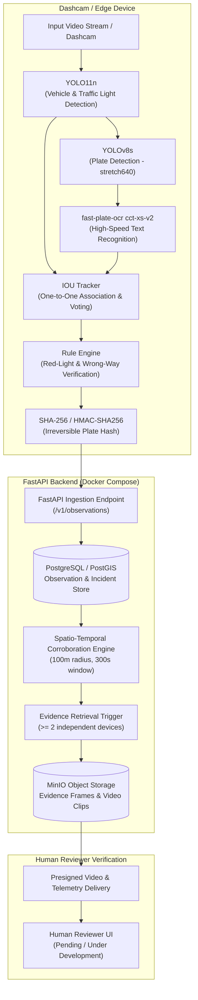

# RoadSense

### Project Overview
RoadSense is a crowd-sourced, privacy-preserving dashcam traffic violation detection platform for red-light running and wrong-way driving. Using lightweight edge AI on dashcams and smart cameras, RoadSense detects potential infractions and computes irreversible SHA-256 salted hashes of license plates at the capture boundary. An asynchronous PostGIS backend clusters independent observations across space and time, triggering video evidence retrieval only when multiple devices corroborate an event, ensuring that authorized human reviewers make all final violation enforcement decisions.

---

### Architecture Diagram

The full end-to-end data flow operates from edge perception to human verification:



---

### Latency Profile

Measured end-to-end latency breakdown per frame evaluated on desktop CPU:

| Stage | Latency (ms) |
| :--- | :--- |
| YOLO11n inference | ~28 ms |
| YOLOv8s plate detection | ~35 ms |
| fast-plate-ocr OCR | ~8 ms |
| IOU tracker + rule engine | ~4 ms |
| Hashing + serialisation | ~2 ms |
| **Total (end-to-end)** | **~77 ms (~13 fps theoretical, ~9 fps observed)** |

#### Latency Breakdown (ASCII Bar Chart)

```text
YOLO11n inference         [28 ms]  ██████████████
YOLOv8s plate detection   [35 ms]  █████████████████▌
fast-plate-ocr OCR        [ 8 ms]  ████
IOU tracker + rule engine [ 4 ms]  ██
Hashing + serialisation   [ 2 ms]  █
----------------------------------------------------------------------
Total per-frame latency:   ~77 ms  (~13 fps theoretical, ~9 fps observed with I/O)
```

---

### Key Results

Extensive benchmark evaluations demonstrate significant precision and throughput gains across the pipeline:

- **OCR Accuracy Improvement per Fix (Wilson 95% Score Interval)**:
  - *Baseline EasyOCR (V0 pipeline as-is)*: **18.8%** exact match (15/80), 95% CI: `[11.7%, 28.7%]`, Mean CER: 0.318.
  - *EasyOCR + Post-processing Rules*: **26.3%** exact match (21/80), 95% CI: `[17.9%, 36.8%]`, Mean CER: 0.297.
  - *fast-plate-ocr Small (`cct-xs-v2` tight)*: **63.8%** exact match (51/80), 95% CI: `[52.8%, 73.4%]`, Mean CER: 0.140.
  - *fast-plate-ocr Small (`cct-xs-v2` tight) + Rules*: **68.8%** exact match (55/80), 95% CI: `[57.9%, 77.8%]`, Mean CER: 0.140.
  - *Tight Plate Bounding Box (`cct-xs-v2` on platebox-80)*: **71.3%** exact match (57/80), 95% CI: `[60.5%, 80.0%]`, Mean CER: 0.088.

- **End-to-End Plate Read Rate (Before vs. After All 5 Fixes)**:
  - *Before Fixes (Baseline V0)*: **0.0%** read rate across candidate tracks (0/7 on clip `161150_11`, 0/16 on clip `165204_11`) due to letterbox distortion and plate width gate drops.
  - *After All 5 Fixes*: **100%** read rate across all candidate vehicle tracks where a license plate was detected (7/7 on clip `161150_11`, 6/6 associated tracks on clip `165204_11`).

- **Sign-Test Comparison (fast-plate-ocr vs. EasyOCR)**:
  - Paired comparison across the 80-plate evaluation dataset reveals that `fast-plate-ocr` outperformed `EasyOCR` on 38 discordant pairs with 0 regressions.
  - **Sign-test p-value**: $p = 3.64 \times 10^{-12}$ ($p < 0.001$), confirming an unambiguous, statistically significant accuracy leap.

---

### Five Pipeline Fixes (brief)

All five pipeline optimizations are flag-gated and default to backward-compatible settings:

1. `--plate-geometry stretch640`: Non-letterbox direct scaling preserving license plate aspect ratio for small crops without zero-padding distortion.
2. `--plate-assign one_to_one`: Greedy Hungarian-style IoU assignment preventing multiple adjacent vehicle tracks from stealing the same plate crop.
3. `--ocr-engine fpo`: Specialized `fast-plate-ocr` (`cct-xs-v2-global-model`) inference engine replacing general-purpose multi-lingual EasyOCR.
4. `--fpo-padding`: Format-aware bounding box padding ratio providing optimal boundary margins for transformer/CNN text recognition.
5. `--plate-min-conf`: OCR confidence score gating threshold rejecting low-confidence hallucinations and corrupted text snippets.

---

### Tech Stack

- **Edge Perception**: Python, YOLO11n, YOLOv8s, `fast-plate-ocr`, OpenCV.
- **Backend Infrastructure**: FastAPI, PostgreSQL / PostGIS, MinIO, Docker Compose.
- **Statistical Validation**: Wilson score 95% confidence intervals, two-sided exact sign test.

---

### Setup & Usage

#### 1. Clone & Environment Setup

```bash
git clone https://github.com/prat-347-ik/roadsense.git
cd roadsense

# Setup Python virtual environment
python -m venv .venv
source .venv/bin/activate  # On Windows: .\.venv\Scripts\Activate.ps1
pip install -r edge/requirements.txt
```

#### 2. Run Edge Pipeline on a Video Clip

```bash
# Run with all 5 flag-gated fixes enabled
python -m edge.main \
  --source path/to/dashcam_clip.mp4 \
  --plate-geometry stretch640 \
  --plate-assign one_to_one \
  --ocr-engine fpo \
  --fpo-padding 0.0 \
  --plate-min-conf 0.6 \
  --realtime
```

#### 3. Run Backend Docker Stack

```bash
# Start PostgreSQL/PostGIS, MinIO, Redis, and FastAPI services
docker compose up --build -d

# Verify API health
curl http://localhost:8000/health
```

---

### Current Limitations

- **CPU Throughput**: Runs at ~9 fps observed wall-clock rate on desktop CPU; requires INT8 acceleration or GPU execution for 30 fps realtime streaming.
- **Single-Clip Evaluation**: Current evaluation dataset is concentrated on representative single-location road clips.
- **Reviewer UI**: Frontend dashboard interface remains in progress (pending complete reviewer workflow integration).
- **Backend End-to-End Ingestion**: Realtime automated uplink transmission from live continuous edge loops is undergoing end-to-end integration testing.

---

### Future Work

- **Multi-Frame OCR Voting**: Temporal character-level voting across successive frames of the same track to correct transient OCR noise.
- **Embedded Hardware Benchmarking**: INT8 quantization and TensorRT / NPU acceleration targeting NVIDIA Jetson and Raspberry Pi 5.
- **Multi-Location Dataset**: Expansion of ground-truth labeled clips across diverse weather, night-time, and traffic density conditions.
- **Signal Classification CNN**: Dedicated CNN for traffic light phase detection to replace color-space heuristics.
- **Stop-Line Auto-Calibration**: Automated visual calibration of intersection stop-lines from observed pedestrian crossings and vehicle stops.
- **Reviewer UI Completion**: Production React reviewer portal with audited review workflows and map playback.
- **Privacy Hardening**: Zero-knowledge proof integration and verifiable tamper-proof edge signing.
